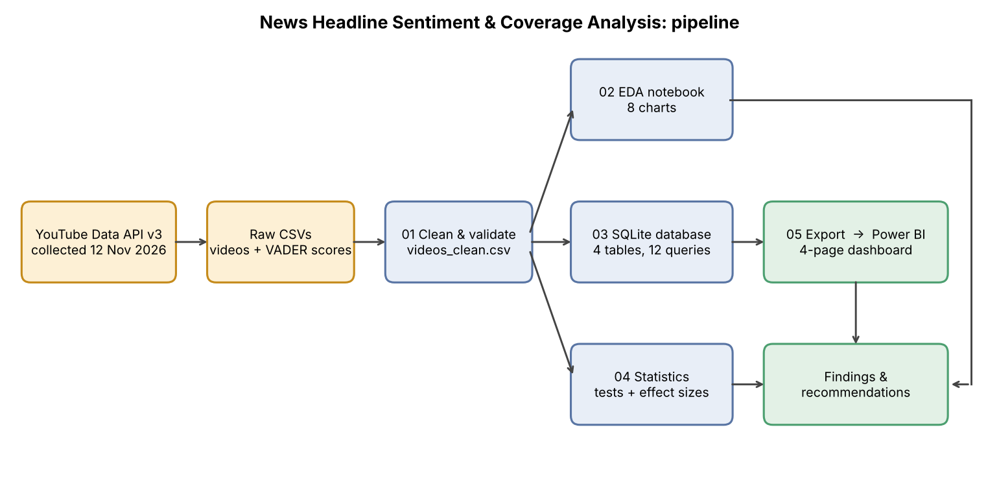
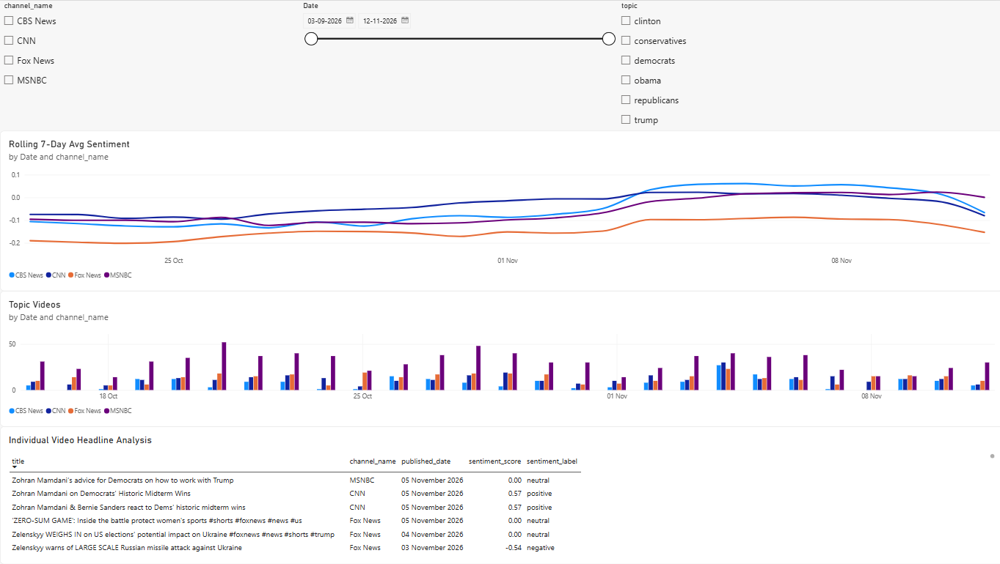

# News Headline Sentiment & Coverage Analysis: Four YouTube News Channels

An end-to-end data analysis of 8,000 YouTube video headlines from CBS News, CNN, Fox News and MSNBC. It asks two questions: **do the channels cover political topics at different rates, and do their headlines differ in tone?** The project covers data validation, EDA, SQL, statistical testing, a Power BI dashboard, and written findings.

> **Scope note:** this analyses video **titles (headlines)**, not comments. Sentiment is a VADER score of the wording. It does not measure what a channel believes or what viewers think.



## Key findings
- **Coverage is the clearest difference.** MSNBC titles mention the tracked political topics in 43% of headlines against 22% to 25% for the others (full snapshot). Over the same dates the gap is 17.3 percentage points (95% CI 14.7 to 20.0).
- **Tone differences are small.** Fox headlines score lowest (mean -0.160; 44.6% negative vs 34.0% to 38.6%). This holds in every robustness check, but the effect is negligible to small (Cliff's delta 0.09 to 0.16).
- **CBS, CNN and MSNBC are indistinguishable in tone** once compared over the same dates.
- **A claim that did not hold up:** the original notebook suggested MSNBC was more negative on Trump. With corrected tests on this snapshot, no channel difference survives.

Full write-up with evidence and caveats: [docs/findings.md](docs/findings.md)

## Dashboard
Four-page Power BI dashboard (Overview, Channel Comparison, Detailed Analysis, Statistical Evidence).

<!-- Add your screenshots to powerbi/screenshots/ and keep these lines -->





## Tech stack
Python (pandas, NumPy, SciPy, Matplotlib, Seaborn), NLTK VADER, SQLite, SQL, Jupyter, Power BI (DAX).

## Methods
| Stage | What was done |
|---|---|
| Cleaning | Validated 8,000 rows: 0 missing values, 0 duplicate IDs, 47 repeated titles flagged. Recomputed VADER on every title and matched the stored scores exactly. |
| EDA | 9-section notebook: score distributions, label shares, topic coverage, time-matched trends, extreme headlines, and a check on excluding neutral headlines. |
| SQL | 4-table SQLite database with primary and foreign keys and 12 queries (joins, `CASE WHEN`, CTEs, subqueries, window functions), cross-checked against pandas. See [docs/sql_documentation.md](docs/sql_documentation.md). |
| Statistics | Kruskal-Wallis, pairwise Mann-Whitney with Holm correction, chi-square, effect sizes, and robustness checks (time-matched window, no repeated titles, day-level Friedman test). |
| Dashboard | Star-schema model, DAX measures, four pages. |

## Project structure
```
src/            01_clean_data.py, 03_build_database.py, 04_statistics.py, 05_export_for_powerbi.py
notebooks/      02_eda.ipynb
sql/            schema.sql, queries.sql
reports/        data_quality_report.md, sql_results.md, statistics_results.md
figures/        EDA charts, architecture diagram
docs/           findings.md, sql_documentation.md, powerbi_guide.md, architecture.md
powerbi/        screenshots (and the report file, if you share it)
legacy/         original collection code and notebook, kept for reference
data/           not committed; see data/README.md
```

## How to run
```
python -m venv venv
venv\Scripts\activate            # Windows (use: source venv/bin/activate on macOS/Linux)
pip install -r requirements.txt
python -c "import nltk; nltk.download('vader_lexicon')"

# place videos.csv and sentiments.csv in data/raw/ (see data/README.md)
python src/01_clean_data.py
# open notebooks/02_eda.ipynb and Run All
python src/03_build_database.py
python src/04_statistics.py
python src/05_export_for_powerbi.py
```

## Data
The data was collected on **12 Nov 2026** with the YouTube Data API v3: each channel's latest 2,000 uploads. Because the window is "latest 2,000", channels cover different periods (MSNBC 27 days, CBS 69 days), so comparisons are also run on a time-matched window of whole days (16 Oct to 11 Nov, 5,361 videos). The data files are not committed; see [data/README.md](data/data_README.md).

## Limitations
- Headlines, not comments: results say nothing about audience opinion.
- VADER scores word tone. Event words (riots, attack) score negative whatever the stance, and some positive scores are misreadings.
- Short snapshot (27 to 69 days) that includes midterm election coverage, so tone and topic coverage may be event-driven.
- Tests assume independent headlines; same-day headlines share news events, so the day-level test is included as a check.
- VADER has not been validated against hand-labelled headlines (the most useful next step).

## Documentation
[Findings](docs/findings.md) | [SQL documentation](docs/sql_documentation.md) | [Architecture](docs/architecture.md)

Author: Yuvraj Negi
