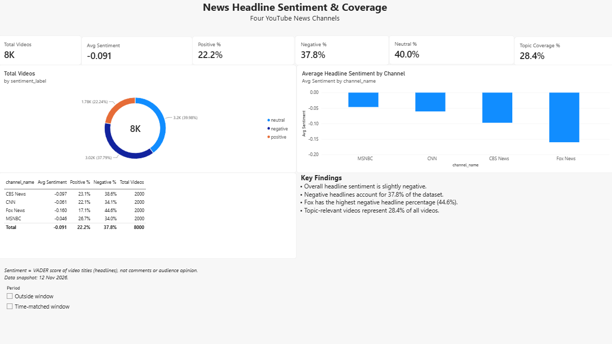
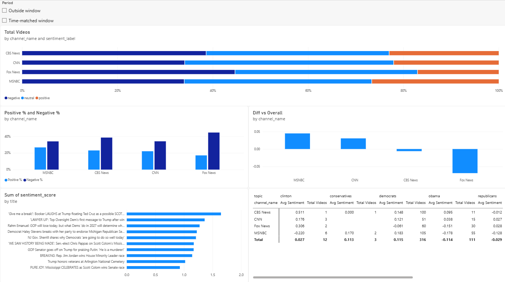
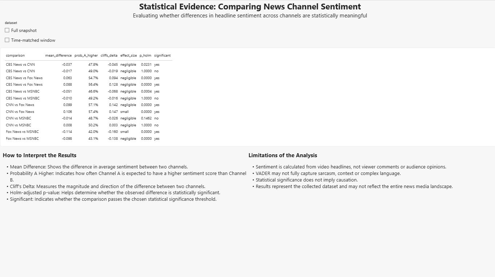

# News Headline Sentiment & Coverage Analysis: Four YouTube News Channels

An end-to-end data analysis of 8,000 YouTube video headlines from **CBS News**, **CNN**, **Fox News**, and **MSNBC**. This project investigates two primary questions: **do the channels cover political topics at different rates, and do their headlines differ in tone?** The pipeline encompasses data validation, relational database design (SQL), rigorous statistical testing, a four-page Power BI dashboard, and documented written findings.

> **Scope Note:** This analysis evaluates video **titles (headlines)**, not viewer comments. Sentiment is measured via VADER polarity scoring of the headline wording; it reflects lexical tone rather than editorial intent or audience opinion.


---

## Key Findings

- **Topic Coverage Shows the Clearest Divergence:** MSNBC titles mention tracked political topics in **43%** of headlines, compared to **22%–25%** for the other three networks across the full snapshot. Over a time-matched window, the gap remains **17.3 percentage points** (95% CI: 14.7 to 20.0).
- **Headline Tone Differences Are Statistically Significant but Small:** Fox News headlines register the lowest average sentiment (mean $-0.160$; $44.6\%$ negative vs. $34.0\%–38.6\%$ for others). While consistent across every robustness check, the practical effect size is negligible to small (Cliff's $\delta = 0.09\text{ to }0.16$).
- **Baseline Parity Among CBS, CNN, and MSNBC:** Once compared over identical calendar dates, no statistically significant difference in headline tone was detected among CBS, CNN, and MSNBC.
- **Re-evaluating Prior Assumptions:** Preliminary exploratory work suggested MSNBC was significantly more negative on coverage mentioning Donald Trump. Under corrected non-parametric testing on this snapshot, no statistically significant inter-channel difference survives.

For a complete breakdown of methodology, statistical tables, and caveats, see [docs/findings.md](docs/findings.md).

---

## Interactive Dashboard

An interactive, four-page Power BI report exploring coverage rates, sentiment distributions, temporal trends, and statistical test results:
1. **Overview**
2. **Channel Comparison**
3. **Detailed Analysis**
4. **Statistical Evidence**

**[View Live Power BI Dashboard](https://app.powerbi.com/links/gMINzfw585?ctid=1490b17d-5dc9-4cbf-aeba-a2e854f521b8&pbi_source=linkShare)**

### Dashboard Previews






---

## Tech Stack

- **Data Processing & Statistics:** Python (`pandas`, `NumPy`, `SciPy`, `NLTK VADER`)
- **Visualization:** `Matplotlib`, Power BI (`DAX`, Star Schema)
- **Database & Querying:** SQLite, SQL

---

## Methodology Overview

| Stage | Description |
| :--- | :--- |
| **Data Validation** | Audited 8,000 records: verified 0 missing values and 0 duplicate video IDs, flagged 47 repeated titles, and recomputed VADER scores to confirm 100% alignment with raw inputs. |
| **Database & SQL** | Designed a normalized 4-table SQLite schema with primary/foreign keys and authored 12 analytical queries (joins, `CASE WHEN`, CTEs, subqueries, window functions), cross-validated against `pandas`. See [docs/sql_documentation.md](docs/sql_documentation.md). |
| **Statistical Testing** | Applied Kruskal-Wallis tests, pairwise Mann-Whitney $U$ tests with Holm-Bonferroni correction, Chi-square tests, and effect size metrics (Cliff's $\delta$, Cramér's $V$). Validated via robustness checks (time-matched window, deduplicated titles, and day-level Friedman tests). |
| **BI Reporting** | Built a star-schema semantic model with custom DAX measures across four interactive report pages. |

---

## Project Structure

```text
news-headline-sentiment/
├── data/               # Raw, processed, and Power BI export data (gitignored)
├── docs/               # Written findings, SQL documentation, Power BI guide, architecture
├── figures/            # Generated statistical charts and pipeline architecture diagram
├── legacy/             # Original data collection scripts and exploratory notebook
├── notebooks/          # run_pipeline.ipynb: runs the four pipeline scripts in order
├── powerbi/            # Dashboard screenshots (the .pbix report is kept local)
├── reports/            # Automated data quality, SQL verification, and statistical outputs
├── sql/                # Database DDL schema and analytical SQL queries
├── src/                # Modular Python ETL, database, statistics, and export scripts
├── .gitignore
├── README.md
└── requirements.txt
```

---

## Getting Started

### 1. Environment Setup

```bash
git clone <your-repository-url>
cd news-headline-sentiment

python -m venv venv
# Windows:
venv\Scripts\activate
# macOS/Linux:
# source venv/bin/activate

pip install -r requirements.txt
python -c "import nltk; nltk.download('vader_lexicon')"
```

### 2. Run the Pipeline

Place `videos.csv` and `sentiments.csv` inside `data/raw/` (refer to [data/data_description.md](data/data_description.md) for schema requirements), then execute the pipeline scripts sequentially:

```bash
python src/01_clean_data.py
python src/03_build_database.py
python src/04_statistics.py
python src/05_export_for_powerbi.py
```

Alternatively, open `notebooks/run_pipeline.ipynb` and click **Run All** to run the same four scripts in order.

---

## Data & Sampling Window

Data was collected on **12 Nov 2026** via the YouTube Data API v3, capturing the **2,000 most recent uploads** per channel ($N = 8,000$). Because upload frequency varies by network, the 2,000-video window spans different timeframes (e.g., 27 days for MSNBC vs. 69 days for CBS News). To control for temporal confounding, all core hypotheses are also evaluated on a **time-matched window** of overlapping full days (**16 Oct – 11 Nov 2026**, $n = 5,361$ videos). Raw datasets are excluded from version control; see [data/data_description.md](data/data_description.md).

---

## Limitations

- **Headlines vs. Content/Comments:** Findings reflect headline framing only and do not capture full video transcripts or audience sentiment.
- **Lexicon Constraints:** VADER relies on rule-based lexical polarity. Hard-news terms (e.g., *attack*, *crisis*, *riot*) register negative scores regardless of journalistic neutrality or stance.
- **Event-Driven Window:** The 27-to-69-day window overlaps with U.S. midterm election coverage, which may elevate political topic frequency and negative framing.
- **Autocorrelation:** Standard non-parametric tests assume independent observations; because same-day headlines react to shared breaking news, day-level Friedman tests are included as a sensitivity check.
- **Future Work:** Validating VADER classifications against a human-annotated sample of news headlines is recommended as the highest-value next step.

---

## Documentation

- [Detailed Analytical Findings](docs/findings.md)
- [SQL Schema & Query Documentation](docs/sql_documentation.md)
- [System Architecture](docs/architecture.md)
