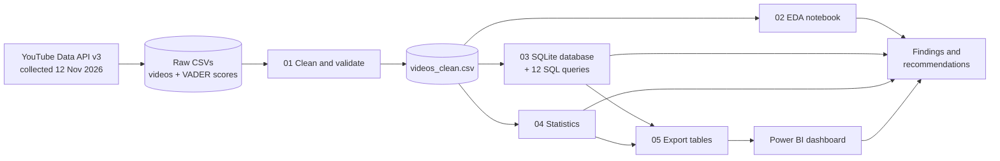

# Architecture

| Stage | Script / file | Input | Output |
|---|---|---|---|
| Collection (legacy) | `legacy/my_code/youtube_api.py`, `language_api.py` | channels.csv, topics.csv | raw CSVs with VADER scores |
| 1 Clean | `src/01_clean_data.py` | raw CSVs | `data/processed/videos_clean.csv`, `reports/data_quality_report.md` |
| 2 EDA | `notebooks/02_eda.ipynb` | videos_clean.csv | 8 charts in `figures/` |
| 3 SQL | `src/03_build_database.py`, `sql/*.sql` | videos_clean.csv | `data/news.db`, `reports/sql_results.md` |
| 4 Statistics | `src/04_statistics.py` | videos_clean.csv | `reports/statistics_results.md`, `figures/08_mean_ci.png` |
| 5 Dashboard | `src/05_export_for_powerbi.py`, `docs/powerbi_guide.md` | news.db | `powerbi/data/*.csv`, Power BI report |
| 6 Findings | `docs/findings.md` | stages 2 to 5 | written findings and recommendations |
