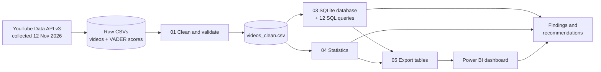

# Architecture

| Step | Script / file | Input | Output |
|---|---|---|---|
| Collection (legacy) | `legacy/my_code/youtube_api.py`, `language_api.py` | `channels.csv`, `topics.csv` | raw CSVs with VADER scores |
| Clean | `src/01_clean_data.py` | raw CSVs | `data/processed/videos_clean.csv`, `reports/data_quality_report.md` |
| SQL | `src/02_build_database.py`, `sql/*.sql` | `videos_clean.csv` | `data/news.db`, `reports/sql_results.md` (local) |
| Statistics | `src/03_statistics.py` | `videos_clean.csv` | `reports/statistics_results.md`, `figures/08_mean_ci.png` |
| Dashboard | `src/04_export_for_powerbi.py` | `news.db` | `powerbi/data/*.csv` for Power BI |
| Findings | `docs/findings.md` | SQL, statistics and dashboard results | written findings and recommendations |

Script numbers keep their original names (there is no `02`), so the run order is 01, 03, 04, 05.
