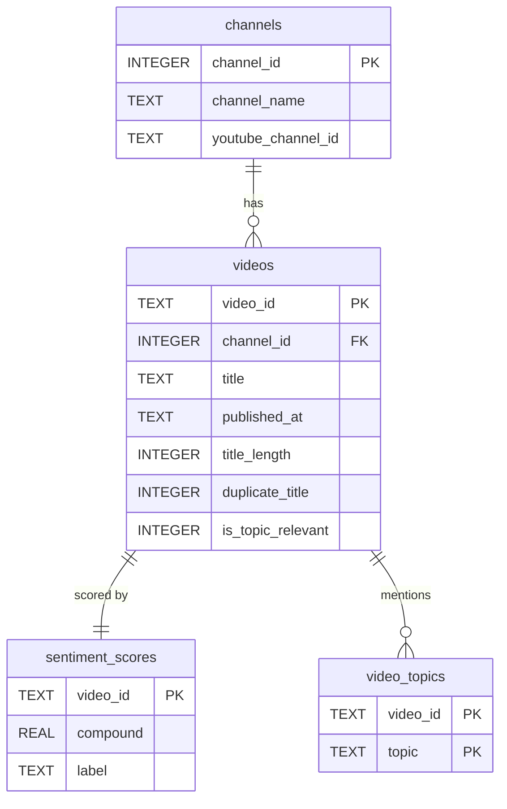

# SQL Documentation

Database: SQLite (`data/news.db`), built by `src/03_build_database.py` from `sql/schema.sql`. Queries are in `sql/queries.sql`; their output is in `reports/sql_results.md`.

## Schema

| Table | Rows | Why it exists |
|---|---|---|
| channels | 4 | One row per channel, so names are stored once |
| videos | 8,000 | One row per video: title, date, topic flag |
| sentiment_scores | 8,000 | VADER score (unchanged) and label, kept separate from video metadata |
| video_topics | 2,483 | One row per (video, topic), because a video can match several topics |

Constraints: primary keys, foreign keys (checked with `PRAGMA foreign_key_check`), `CHECK` limits on the score range and label values.

## Queries

| Q | Business question | Skills | Result highlight |
|---|---|---|---|
| 1 | Which channel has the highest share of negative headlines? | JOIN, GROUP BY, CASE WHEN, RANK() | Fox 44.6% (rank 1); CBS 38.55%; CNN and MSNBC about 34% |
| 2 | How does the positive/neutral/negative split vary? | GROUP BY, conditional aggregates | MSNBC highest positive share (26.7%); Fox lowest (17.1%), with a positive-to-negative ratio of 0.38 vs 0.60 to 0.79 |
| 3 | Mean, min, max and spread of scores per channel | aggregates | Means from -0.160 (Fox) to -0.046 (MSNBC); spread similar (SD 0.36 to 0.39) |
| 4 | How much data per channel, over what period? | MIN/MAX, julianday | MSNBC 27.8 days at 72 videos/day; CBS 69.5 days at 28.8/day |
| 5 | Share of headlines mentioning a tracked topic | JOIN, SUM of a flag | MSNBC 42.85% vs 22.25% to 25.4% |
| 6 | Average sentiment by channel and topic (groups of 30+) | 3-table JOIN, HAVING | Hides groups too small to trust |
| 7 | Topic vs other headlines per channel | CASE WHEN as group label | Topic headlines less negative for CBS, CNN, Fox; more negative for MSNBC |
| 8 | Comparison over the same dates only | CTEs, CROSS JOIN, date functions | Fox -0.148 vs -0.042 to -0.059; 5,361 videos |
| 9 | Three most negative headlines per channel | ROW_NUMBER() OVER (PARTITION BY) | Driven by event words (attacks, riots, rape, war) |
| 10 | Which channels are below the overall mean? | scalar subquery | Fox -0.069 and CBS -0.006 below; CNN and MSNBC above |
| 11 | 7-day rolling average sentiment | SUM() OVER with ROWS frame | Matches the Power BI and Stage 2 trend values |
| 12 | Which headlines appear more than once? | HAVING, GROUP_CONCAT | 47 repeated titles, nearly all within one channel |

## Notes
- SQLite has no standard-deviation function, so Q3 computes the population SD from averages.
- Percentages sit on rounding boundaries in places (CBS negative 38.55%), so SQLite and pandas can differ by 0.1 when rounded. The build script compares exact counts.
- The build script cross-checks the negative counts per channel against pandas and fails if they differ.
